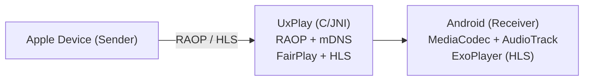

# airplay-chromecast

> **Fork of [jqssun/android-airplay-server](https://github.com/jqssun/android-airplay-server), under the [GPL-3.0](LICENSE).**
> The receiver, its Android app and its patches to [UxPlay](https://github.com/FDH2/UxPlay) are the work of jqssun and the upstream contributors.
> This fork only changes how the app is built for one device. The fork notes come first; the [upstream README](#airplay-receiver-for-android) follows, unchanged.

## What it is and why

An AirPlay receiver for a Chromecast with Google TV, so an iPhone or a Mac can mirror its screen, or play video and music, on a TV that has no AirPlay of its own (older LG webOS sets, for example).
The other options were buying an Apple TV, or a closed-source receiver app; see [Design decisions](#design-decisions).

## What differs from upstream

| Change | Where | Why |
|---|---|---|
| Native code built for `arm64-v8a` and `armeabi-v7a` only, no `x86_64` | `allAbis` in `app/build.gradle.kts` | The Chromecast with Google TV runs a 32-bit ARM userspace; `x86_64` only serves emulators and lengthens every build. |

Everything else is upstream's: code, resources, app name and application ID (`io.github.jqssun.airplay`).

## How it works

```text
iPhone / Mac  -- finds the receiver over mDNS (same subnet) -->
     |  AirPlay: mirroring stream, audio stream, or an HLS URL for video
     v
Chromecast with Google TV, app running as a foreground service
     UxPlay (C, through JNI): AirPlay/RAOP protocol, pairing, FairPlay
     MediaCodec: H.264/H.265 video, AAC/ALAC audio (software fallbacks)
     ExoPlayer: HLS video through a local playlist proxy
     |  HDMI
     v
    TV
```

With the upstream defaults (`auto_start`, `boot_auto_start`), the receiver starts with the app and again after each reboot of the Chromecast, so nobody has to open the app first.

## Requirements

- JDK 21 (the upstream CI uses Zulu 21; on macOS, `brew install openjdk@21`).
- Android SDK with platform 37, NDK `27.0.12077973` and CMake 3.22.1 (versions pinned in `app/build.gradle.kts` and `app/src/main/cpp/CMakeLists.txt`), and a `local.properties` with `sdk.dir=...`.
- `git` on the `PATH`: the build applies patches inside the UxPlay submodule.
- A device running Android 7.0 or later, on the same subnet as the senders, with developer options and wireless debugging turned on for the install.

## Build

```sh
git clone --recurse-submodules https://github.com/TheBenBenJ/airplay-chromecast
cd airplay-chromecast
export JAVA_HOME="$(brew --prefix openjdk@21)"   # macOS
./gradlew assembleDebug                           # first build compiles FFmpeg and OpenSSL: a few minutes
# APK: app/build/outputs/apk/debug/app-debug.apk
```

`.github/workflows/apk.yml` is upstream's release workflow. It runs on `release/**` branches, `v*` tags or by hand, and needs two secrets this repo does not define: `STORE` (the signing keystore) and `LOCAL` (a `local.properties` with the signing settings). Builds for this fork are local debug builds.

### UxPlay and its patches

UxPlay is the official repository (`FDH2/UxPlay`) at upstream's pinned commit `df67c21`, and this repo's changes to it live only in `app/src/main/cpp/patches/UxPlay/*.patch`: before CMake runs, the `applyUxplayPatches` Gradle task resets the UxPlay files that the patches touch, then applies them. The same as upstream does.

From 30/10 to 03/11/2026 the submodule pointed to a fork whose single commit (`d01cfb4`) held the same nine patches, already applied, so the task failed with `patch does not apply`. The fork was checked byte for byte equal to `df67c21` plus the patches, then dropped: one source for the changes, upstream's layout kept.

## Install

On the device: Settings > System > Developer options > Wireless debugging > Pair device with pairing code. Then, on the computer:

```sh
adb pair <device-ip>:<pairing-port>     # once, with the code shown on the TV
adb mdns services                       # the connection port changes each time wireless debugging is turned on
adb connect <device-ip>:<port>
adb -s <device-ip>:<port> install -r app/build/outputs/apk/debug/app-debug.apk
```

Name the receiver as it should appear in the AirPlay list (upstream settings receiver, see [Configure from ADB](#configure-from-adb)):

```sh
adb -s <device-ip>:<port> shell am broadcast -n io.github.jqssun.airplay/.SettingsReceiver \
  -a io.github.jqssun.airplay.SET_SETTING --es key server_name --es value "<receiver name>"
```

## Operations and troubleshooting

- **Receiver not listed on the iPhone or Mac.** Sender and Chromecast must be on the same subnet, without client isolation (guest Wi-Fi often blocks mDNS). Open the app once if the service did not start, and check that `boot_auto_start` is `true` with the `LIST_SETTINGS` broadcast.
- **`adb connect` refused.** The port changed: run `adb mdns services` again. With several devices connected, pass `-s <device-ip>:<port>` to every command.
- **`INSTALL_FAILED_UPDATE_INCOMPATIBLE`.** The installed app was signed with another key, for example the upstream Google Play or F-Droid build, which uses the same application ID. Uninstall it first (its settings are lost) or build on the machine that signed it.
- **Logs.** In the app (Logs screen), or `adb -s <device> logcat --pid=$(adb -s <device> shell pidof io.github.jqssun.airplay)`.
- **Some video apps do not play.** DRM-protected content (Apple TV app and similar) is not supported upstream.
- **Changing a setting drops the session.** Settings marked `restart = true` in `Prefs.kt` (name, port, codecs, PIN...) make the service restart the AirPlay server a moment after the change.

The TV remote control and the HDMI-CEC wake-up of the TV are handled outside this repo (see [homebridge-chromecast](https://github.com/TheBenBenJ/homebridge-chromecast)).

## Security notes

- Anyone on the local network can find the receiver and cast to it, and with the default `allow_new_conn` a new sender drops the current one. Turn on `require_pin` if the network is shared.
- The settings receiver is protected by `android.permission.DUMP`: only `adb shell` and the system can change settings, not other installed apps.
- Wireless debugging gives full control of the device to every paired computer. Pair only your own machines, and turn it off when it is not needed.
- A debug build is debuggable (`run-as` works over adb). That is acceptable on a home TV device; for anything else, build a release with your own signing key.
- Never commit `local.properties` or a keystore: both are in `.gitignore`.

## Design decisions

- **A receiver app on the Chromecast, not an Apple TV.** The Chromecast was already plugged into the TV; buying an Apple TV for AirPlay alone was not worth it.
- **This upstream, not a closed-source receiver.** Commercial apps such as AirScreen do the same job, but they are network-facing services whose code cannot be read or rebuilt. jqssun/android-airplay-server is GPL-3, supports AirPlay 2 mirroring, audio and HLS video, supports Android TV remote navigation, and is actively maintained.
- **Built from source, not installed from Google Play or F-Droid.** The code that runs on the device is the code in this repo, and it can be customised later (app name, headless start, latency) without waiting for upstream. Until then nothing is customised: see the next point.
- **Minimal divergence from upstream.** No code change, and the application ID and app name are kept, so merging `upstream/main` can only conflict on the `allAbis` line. Renaming the app would touch many files and make every merge conflict. Cost: this build cannot be installed next to the upstream one.
- **ARM only.** The target device runs a 32-bit ARM userspace (`armeabi-v7a`). `arm64-v8a` stays so the same APK also runs on 64-bit ARM devices. `x86_64` is dropped: it only serves emulators, and each ABI rebuilds FFmpeg and OpenSSL from source.
- **UxPlay changes as patches on the official repository, not as a fork.** Upstream works this way, the changes stay readable in this repository, and moving to a newer UxPlay is a submodule bump plus a patch refresh. A fork carrying the same patches was tried (30/10/2026) and dropped: it duplicated the patches and broke the patch step.
- **Upstream release workflow left as is.** Release signing and store publishing do not apply to a single home device, and editing the workflow would only add merge conflicts.

## License

GPL-3.0, see [LICENSE](LICENSE), unchanged from upstream. This fork's changes are under the same license. Credits for the receiver go to jqssun and the upstream contributors; third-party components are listed in the upstream README below.

---

# AirPlay Receiver for Android

[](https://github.com/jqssun/android-airplay-server)
[](https://github.com/jqssun/android-airplay-server/releases)
[](https://github.com/jqssun/android-airplay-server/blob/main/LICENSE)
[](https://github.com/jqssun/android-airplay-server/actions/workflows/apk.yml)
[](https://github.com/jqssun/android-airplay-server/releases)

A fully featured free and open-source implementation of AirPlay for Android that turns your device into an AirPlay-compatible display and speaker, based on [UxPlay](https://github.com/FDH2/UxPlay). It is the first open-source AirPlay 2 receiver for Android and Android TV, and works with iOS/iPadOS, macOS devices as well as other sender implementations.

[](https://play.google.com/store/apps/details?id=io.github.jqssun.airplay)
[](https://f-droid.org/packages/io.github.jqssun.airplay)
[](https://github.com/jqssun/android-airplay-server/releases/latest)

<video loop src='https://github.com/user-attachments/assets/79ed7c0c-0102-43cc-8816-4f00ce6a4199' alt="demo" width="200" style="display: block; margin: auto;"></video>

## Compatibility

- Android 7.0+, including Android TV
- AirPlay devices on the same subnet, including iOS/iPadOS, macOS devices, or other sender implementations

## Features

- Screen mirroring with H.264 and H.265 (HEVC) video decoding
- Audio streaming with AAC-ELD, AAC-LC and ALAC audio decoding
- Video playback with support for HLS, downloads, and remote controls
- Music playback with track information, cover art, and remote controls
- Support for Android TV with directional pad navigation and seeking controls
- Support for Picture-in-Picture, automatic resolution and mode switching
- Optional PIN authentication
- Video resolution, overscan, and frame rate control
- Audio latency control and support for software decoder fallback
- Debug overlay with real-time statistics (FPS, bitrate, codec, resolution, frame count, audio volume, etc.)
- Android native media session integration with notification controls
- Wired secondary display for macOS/iPadOS devices over USB tethering

> [!WARNING]
> DRM content (e.g. from the Apple TV application) is not supported.

## Configure from ADB

On devices without a display, settings can also be changed over ADB. The receiver is protected by `android.permission.DUMP` so regular installed apps cannot change them. Values are passed as text using `--es`. Using `adb shell`:

```bash
export KEY="server_name" VALUE="Speaker"
am broadcast -n io.github.jqssun.airplay/.SettingsReceiver -a io.github.jqssun.airplay.SET_SETTING --es key "$KEY" --es value "$VALUE"
```

To list all settings with their current values as JSON:

```bash
am start -n io.github.jqssun.airplay/.MainActivity
am broadcast -n io.github.jqssun.airplay/.SettingsReceiver -a io.github.jqssun.airplay.LIST_SETTINGS
```

## Implementation

This application uses the C-based [UxPlay](https://github.com/FDH2/UxPlay) library to implement the AirPlay/RAOP protocol, with a JNI bridge to the Android application layer. Audio can be decoded via MediaCodec or a software ALAC decoder, while mirroring video is decoded via MediaCodec and rendered to a SurfaceView. HLS sessions are served through a local playlist proxy.

When using USB tethering, the Android device can act as a reliable secondary display over a wired connection. Apple devices natively support USB tethering over CDC-NCM, so on Android devices that default to RNDIS, you may need to switch to CDC-NCM over ADB:

```bash
adb shell settings put global tether_force_usb_functions 1
```



CMake is used for native C/C++ components under [`app/src/main/cpp`](app/src/main/cpp). Submodules must be initialized before building. 

```bash
git submodule update --init --recursive
./gradlew assembleDebug
```

Check out the [CI](https://github.com/jqssun/android-airplay-server/blob/main/.github/workflows/apk.yml) for more details on reproducible builds.

## Credits

- [UxPlay](https://github.com/FDH2/UxPlay) for the AirPlay/RAOP server implementation
- [FFmpeg](https://ffmpeg.org) for the lossless audio decoder
- [Next Player](https://github.com/anilbeesetti/nextplayer) for the video player

---

Disclaimer: This project is not affiliated with Apple Inc.
